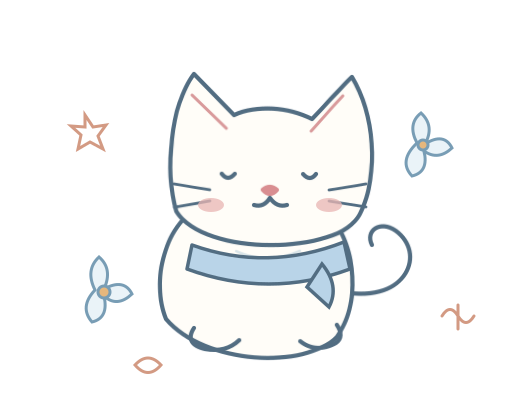

&#x20;\
   \✳ LITTLE NOTES & CURIOUS THINGS\ \

\
   \<strong>Ringakkin\</strong>   \    \<em>浮躁中沉潜，早已知晓所述\</em> \

\
   \<a href="[https://ringakkin.github.io/Website-zhangkun/home.html](https://ringakkin.github.io/Website-zhangkun/home.html)">Website ↗\</a>   &nbsp;·&nbsp;   \<a href="[https://ringakkin.github.io/vue3-tools-docs/](https://ringakkin.github.io/vue3-tools-docs/)">NPM Docs ↗\</a>   &nbsp;·&nbsp;   \<a href="[https://blog.csdn.net/m0_57904695](https://blog.csdn.net/m0_57904695)">CSDN ↗\</a> \

---

### ✿ A little about me

A developer curious about how things work, always learning, exploring, and building useful little things.

### ✎ Currently exploring

`Computer Architecture`　`Operating Systems`

`Programming`　`Automation`　`Open Source`

### ♡ Little things I love

🍜 Good food　🐈 Cats　📒 Stationery　☕ Quiet moments

---

\

&#x20; \
&#x20; \ \ 
&#x20; \Thanks for stopping by. Please let me copy your homework. ♡\
&#x20; \ 
&#x20; \Made with ☕, curiosity, and a little love for cats.\
\

