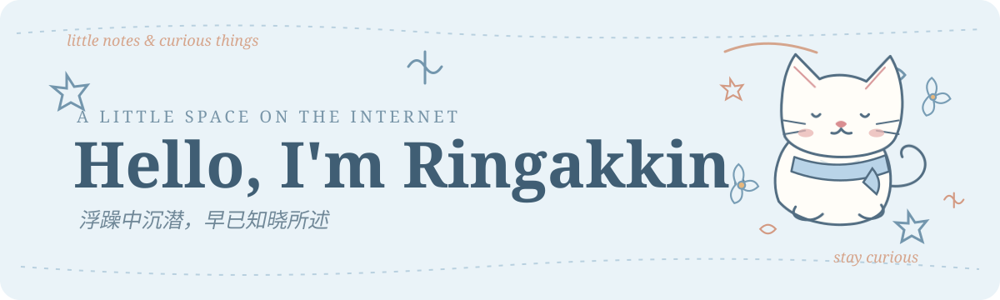
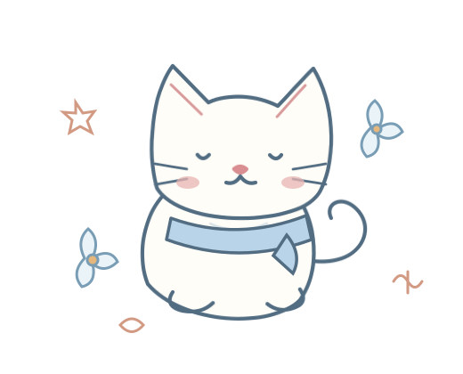

  

  <em>浮躁中沉潜，早已知晓所述</em>

  <a href="https://ringakkin.github.io/Website-zhangkun/home.html">Website</a>
  &nbsp;·&nbsp;
  <a href="https://ringakkin.github.io/vue3-tools-docs/">NPM Docs</a>
  &nbsp;·&nbsp;
  <a href="https://blog.csdn.net/m0_57904695">CSDN</a>

---

### ✿ A little about me

Hi! I'm **Ringakkin** — a developer who enjoys exploring how things work, learning new technologies, and building useful little things.

- 📚 Currently learning **Computer Architecture** and **Operating Systems**
- 💻 Interested in **programming, automation, and open source**
- 🍜 A happy **food lover**
- 🐈 Cat person, stationery admirer, and occasional homework borrower

### ✎ Things I'm exploring

`Computer Architecture`　`Operating Systems`　`Programming`　`Automation`

### ♡ Find me elsewhere

- [Personal Website](https://ringakkin.github.io/Website-zhangkun/home.html)
- [Vue3 Tools Docs](https://ringakkin.github.io/vue3-tools-docs/)
- [CSDN Blog](https://blog.csdn.net/m0_57904695)

---

  
   
  Thanks for stopping by. Please let me copy your homework. ♡
   
  Made with ☕, curiosity, and a little love for cats.

